# Практичні роботи з SQL (MariaDB / MySQL)

Усі запити виконано на MariaDB 10.11, скріншоти зроблено з реальних результатів.

Створення баз: [`01_institut_db.sql`](01_institut_db.sql), [`02_transport_db.sql`](02_transport_db.sql). Усі запити: [`03_institut_queries.sql`](03_institut_queries.sql), [`04_transport_queries.sql`](04_transport_queries.sql).

## Практична робота: база даних «Інститут»

Таблиці: `student` (kod, name, grupa), `vicladachi` (kod, name, predmet), `uspishnist` (kodS, kodV, otsinka) — дані з рис. 1.

### Контрольні задачі

**1. Прізвище студента, прізвище викладача і оцінка, яку отримав цей студент у викладача**

```sql
SELECT student.name, vicladachi.name, uspishnist.otsinka
FROM vyz.student, vyz.vicladachi, vyz.uspishnist
WHERE uspishnist.kodV = vicladachi.kod
  AND student.kod = uspishnist.kodS;
```

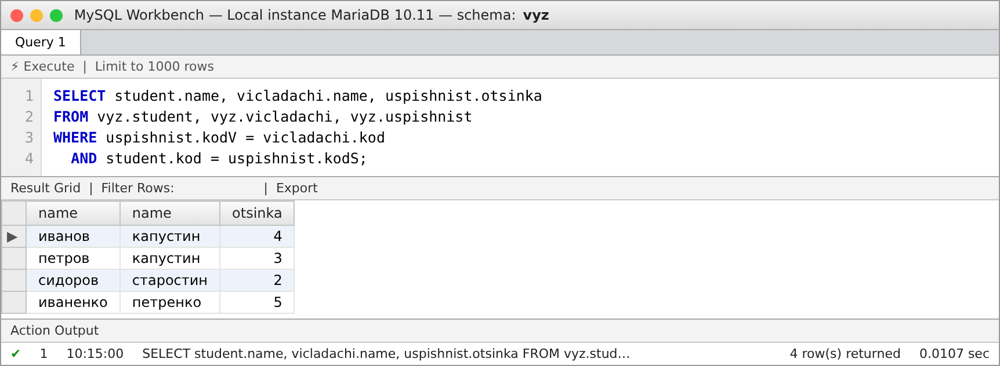

**2. Вивести всіх, хто отримав оцінку = 5**

```sql
SELECT student.name, vicladachi.name, uspishnist.otsinka
FROM vyz.student, vyz.vicladachi, vyz.uspishnist
WHERE uspishnist.kodV = vicladachi.kod
  AND student.kod = uspishnist.kodS
  AND uspishnist.otsinka = 5;
```

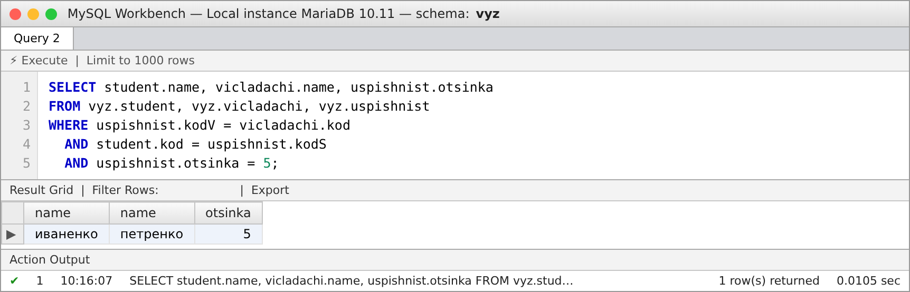

**3. Вивести всіх, в кого прізвище починається з П**

```sql
SELECT student.name, vicladachi.name, uspishnist.otsinka
FROM vyz.student, vyz.vicladachi, vyz.uspishnist
WHERE uspishnist.kodV = vicladachi.kod
  AND student.kod = uspishnist.kodS
  AND student.name LIKE 'П%';
```

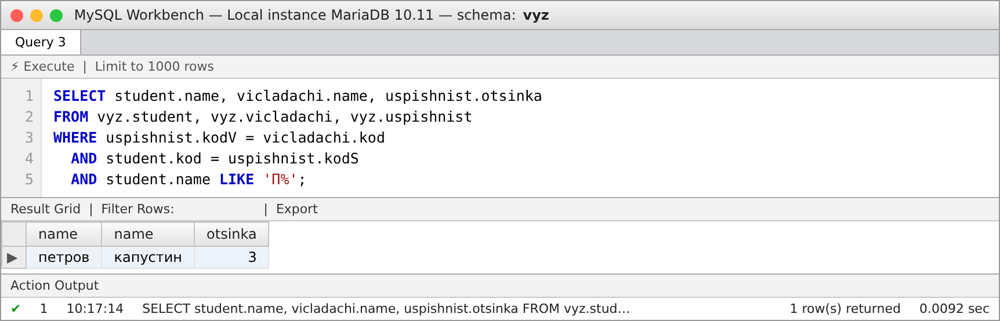

**4. Вивести всіх, хто отримав оцінки 4 або 3**

```sql
SELECT student.name, vicladachi.name, uspishnist.otsinka
FROM vyz.student, vyz.vicladachi, vyz.uspishnist
WHERE uspishnist.kodV = vicladachi.kod
  AND student.kod = uspishnist.kodS
  AND (uspishnist.otsinka = 4 OR uspishnist.otsinka = 3)
ORDER BY student.name;
```

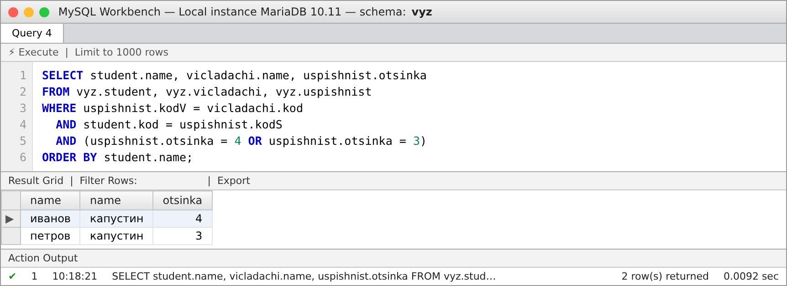

**5. Підрахувати кількість студентів в групі**

```sql
SELECT student.grupa, COUNT(student.name) AS kilkist
FROM vyz.student
GROUP BY student.grupa;
```

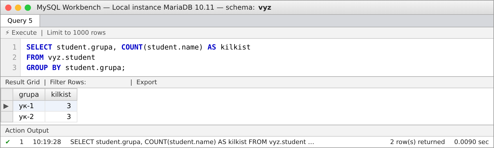

**6. Підрахувати кількість студентів в групі, які не мають 3**

```sql
SELECT student.grupa, COUNT(student.name) AS kilkist
FROM vyz.student
WHERE student.kod NOT IN (SELECT uspishnist.kodS
                          FROM vyz.uspishnist
                          WHERE uspishnist.otsinka = 3)
GROUP BY student.grupa;
```

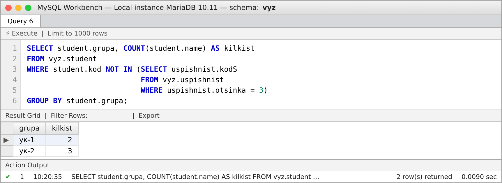

> Задача 6: рахуємо студентів групи, у яких немає жодної оцінки 3 (`NOT IN` з підзапитом). У групі ук-1 оцінку 3 має лише петров, тому 2 студенти; у ук-2 таких немає — 3 студенти.

## Прості запити на вибірку даних мовою SQL — база даних «Транспорт»

База складається з трьох таблиць: `vodii` (водії), `avtomobili` (автомобілі), `reysy` (рейси).

**Таблиця «Водії» (vodii)**

```sql
SELECT * FROM transport.vodii;
```

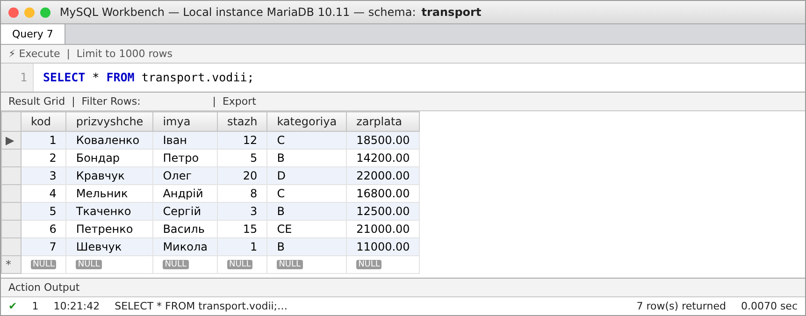

**Таблиця «Автомобілі» (avtomobili)**

```sql
SELECT * FROM transport.avtomobili;
```

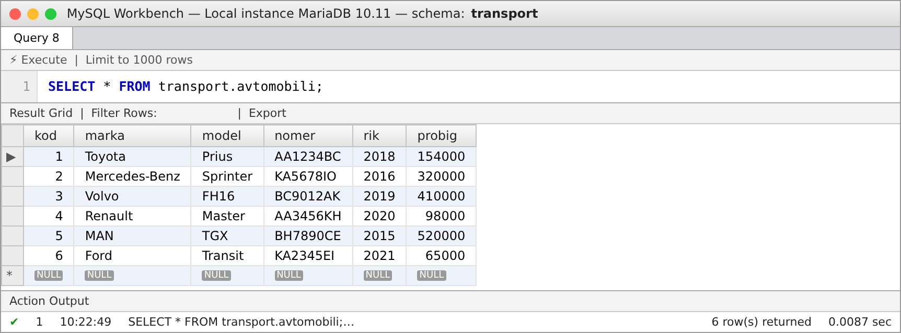

**Таблиця «Рейси» (reysy)**

```sql
SELECT * FROM transport.reysy;
```

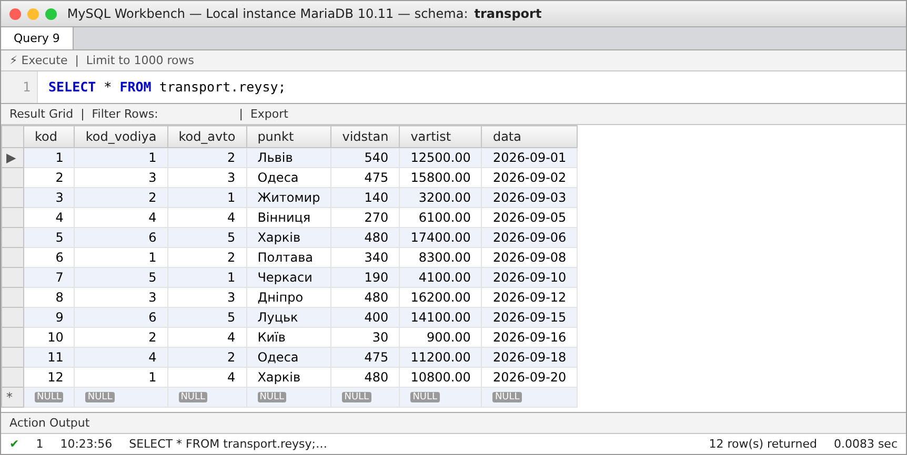

### Завдання 1. Запити зі статистичними функціями

> У MySQL функції `StDev` і `VAR` (з Access) називаються `STDDEV` (або `STD`) і `VARIANCE`.

**1.1 Загальна, середня, мінімальна й максимальна вартість рейсів та їх кількість (SUM, AVG, MIN, MAX, COUNT)**

```sql
SELECT SUM(vartist)   AS suma,
       AVG(vartist)   AS serednie,
       MIN(vartist)   AS minimum,
       MAX(vartist)   AS maksymum,
       COUNT(*)       AS kilkist_reysiv
FROM transport.reysy;
```

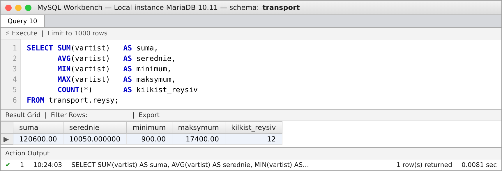

**1.2 Середньоквадратичне відхилення та дисперсія вартості рейсів (у MySQL: STDDEV і VARIANCE)**

```sql
SELECT ROUND(STDDEV(vartist), 2)   AS st_vidhylennia,
       ROUND(VARIANCE(vartist), 2) AS dyspersiia
FROM transport.reysy;
```

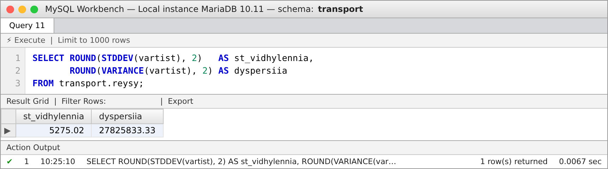

**1.3 Кількість рейсів і сумарна відстань кожного водія (COUNT, SUM з GROUP BY)**

```sql
SELECT kod_vodiya,
       COUNT(*)     AS kilkist_reysiv,
       SUM(vidstan) AS suma_km
FROM transport.reysy
GROUP BY kod_vodiya;
```

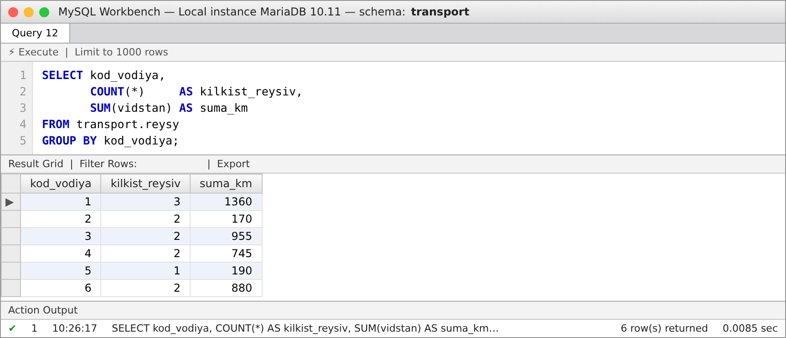

**1.4 Середня, мінімальна й максимальна зарплата водіїв, найбільший стаж**

```sql
SELECT ROUND(AVG(zarplata), 2) AS serednia_zp,
       MIN(zarplata)            AS min_zp,
       MAX(zarplata)            AS max_zp,
       MAX(stazh)               AS max_stazh
FROM transport.vodii;
```

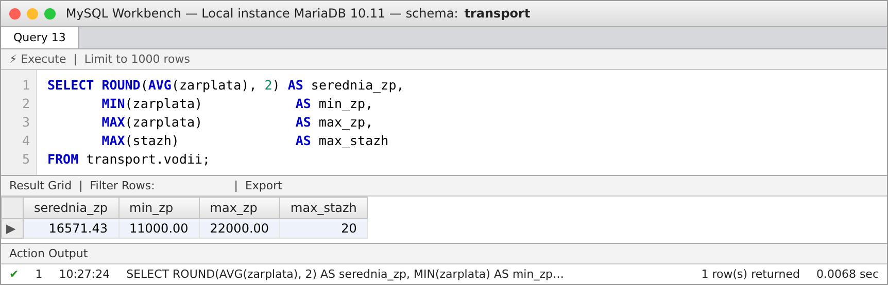

### Завдання 2. Запити з оператором LIKE

**2.1 Водії, прізвище яких починається на «К»**

```sql
SELECT prizvyshche, imya, stazh
FROM transport.vodii
WHERE prizvyshche LIKE 'К%';
```

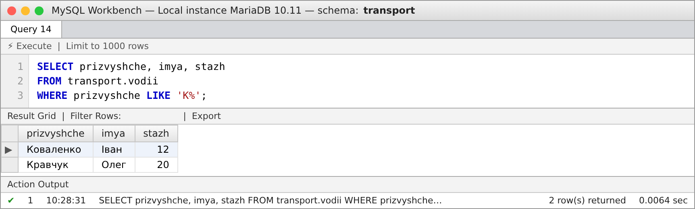

**2.2 Автомобілі з номером, що починається на «AA» (Київ)**

```sql
SELECT marka, model, nomer
FROM transport.avtomobili
WHERE nomer LIKE 'AA%';
```

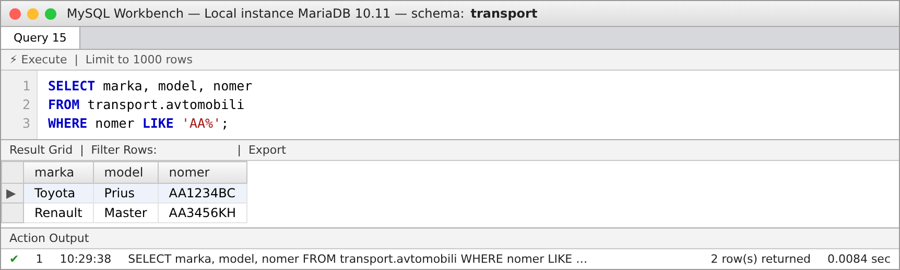

**2.3 Рейси до міст, назва яких закінчується на «ів»**

```sql
SELECT kod, punkt, vidstan
FROM transport.reysy
WHERE punkt LIKE '%ів';
```

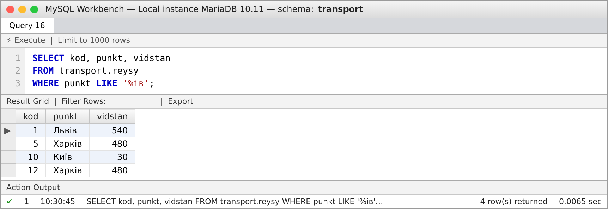

**2.4 Водії, у прізвищі яких друга літера «е» (символ _ — один будь-який символ)**

```sql
SELECT prizvyshche, imya
FROM transport.vodii
WHERE prizvyshche LIKE '_е%';
```

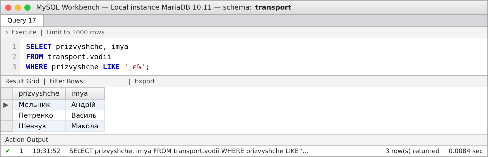

### Завдання 3. Запити з псевдонімами

**3.1 Псевдоніми стовпців (AS)**

```sql
SELECT prizvyshche AS `Прізвище`,
       imya        AS `Ім'я`,
       stazh       AS `Стаж (років)`,
       zarplata    AS `Зарплата, грн`
FROM transport.vodii;
```

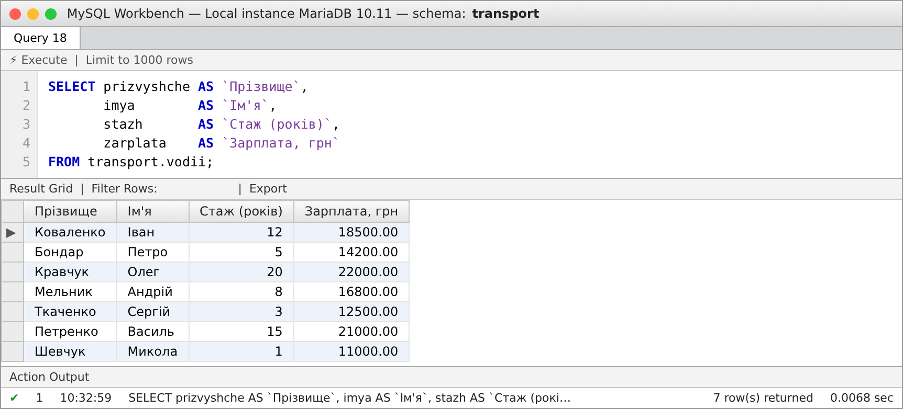

**3.2 Псевдоніми таблиць: хто, на якому автомобілі й куди їздив**

```sql
SELECT v.prizvyshche AS `Водій`,
       a.marka       AS `Марка`,
       a.nomer       AS `Номер`,
       r.punkt       AS `Пункт призначення`
FROM transport.reysy r, transport.vodii v, transport.avtomobili a
WHERE r.kod_vodiya = v.kod
  AND r.kod_avto = a.kod
ORDER BY v.prizvyshche;
```

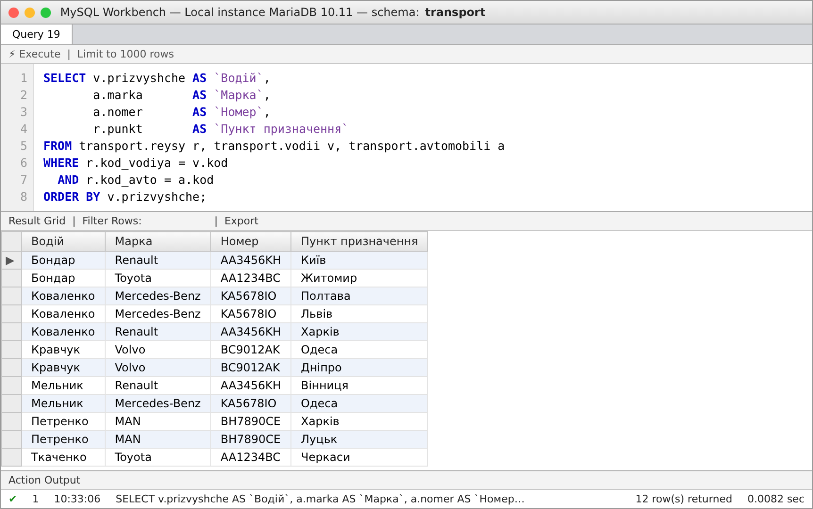

**3.3 Псевдонім для обчислюваного стовпця: ціна за 1 км**

```sql
SELECT r.punkt                           AS `Пункт`,
       r.vidstan                         AS `Км`,
       r.vartist                         AS `Вартість`,
       ROUND(r.vartist / r.vidstan, 2)   AS `Ціна за км`
FROM transport.reysy AS r;
```

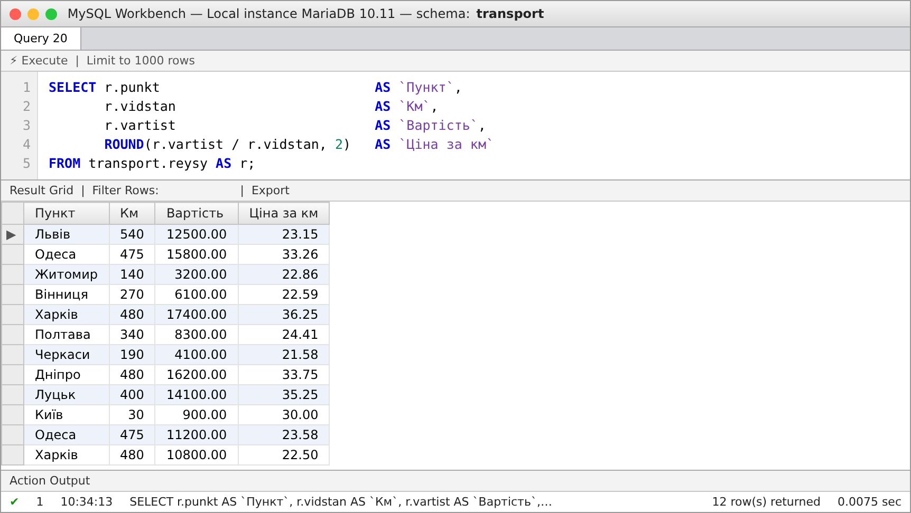

### Завдання 4. Запити з операціями IN та NOT IN

**4.1 Водії з категорією прав C або CE (IN)**

```sql
SELECT prizvyshche, imya, kategoriya
FROM transport.vodii
WHERE kategoriya IN ('C', 'CE');
```

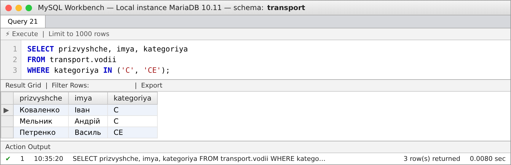

**4.2 Рейси, крім рейсів до Києва, Львова та Одеси (NOT IN)**

```sql
SELECT kod, punkt, vidstan, vartist
FROM transport.reysy
WHERE punkt NOT IN ('Київ', 'Львів', 'Одеса');
```

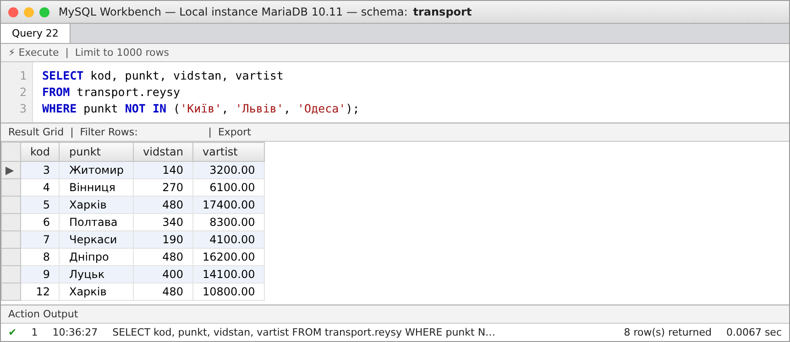

**4.3 Водії, які виконували рейси на автомобілях Volvo або MAN (IN з підзапитом)**

```sql
SELECT prizvyshche, imya
FROM transport.vodii
WHERE kod IN (SELECT kod_vodiya
              FROM transport.reysy
              WHERE kod_avto IN (SELECT kod
                                 FROM transport.avtomobili
                                 WHERE marka IN ('Volvo', 'MAN')));
```

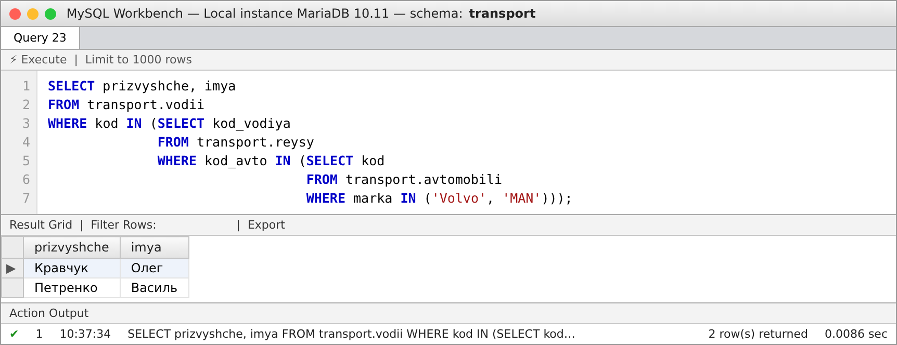

**4.4 Водії, які не виконали жодного рейсу (NOT IN з підзапитом)**

```sql
SELECT prizvyshche, imya, stazh
FROM transport.vodii
WHERE kod NOT IN (SELECT kod_vodiya FROM transport.reysy);
```

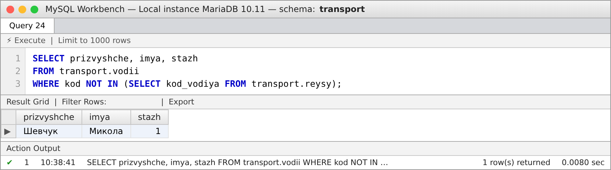

**4.5 Автомобілі, які не використовувались у рейсах (NOT IN з підзапитом)**

```sql
SELECT marka, model, nomer
FROM transport.avtomobili
WHERE kod NOT IN (SELECT kod_avto FROM transport.reysy);
```

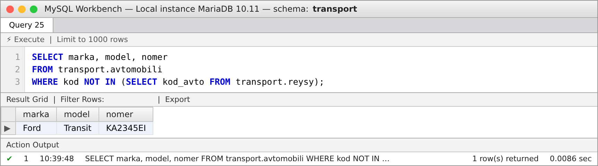
